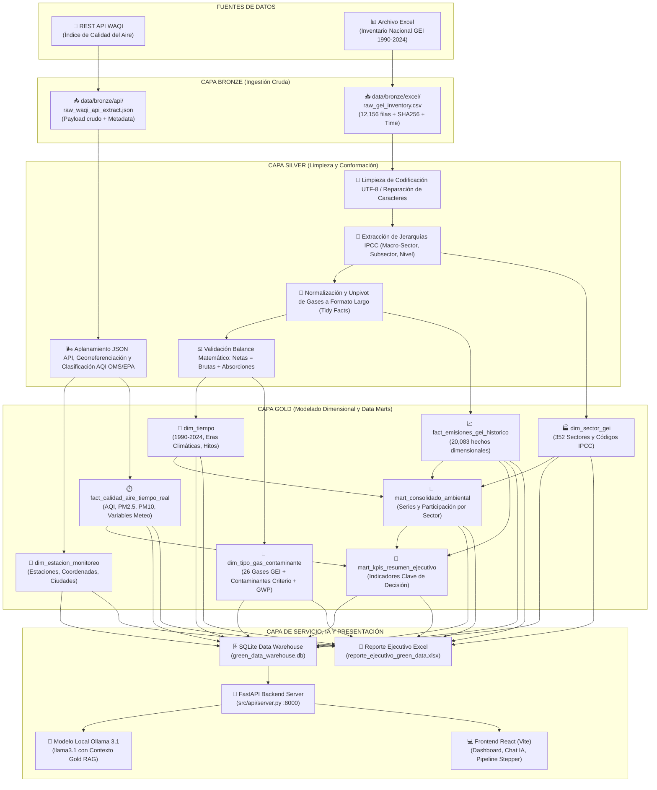
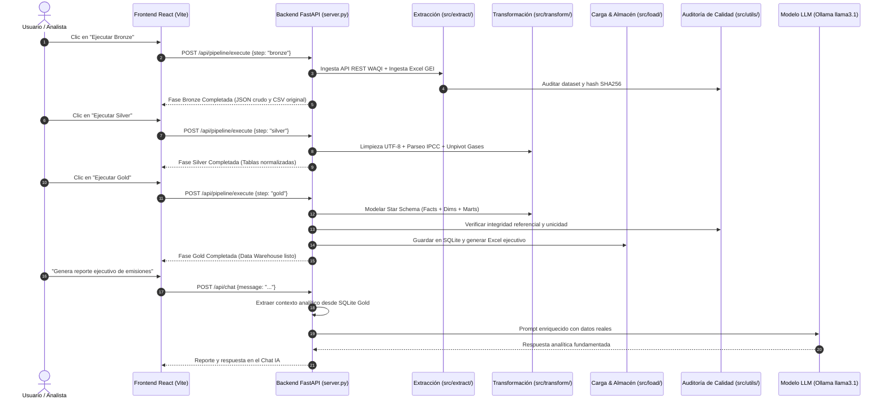
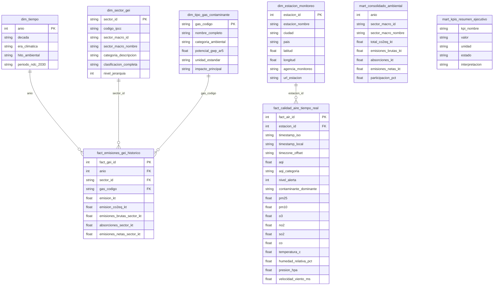

# 🌿 Green Data ETL Pipeline — Arquitectura Medallion

Pipeline de **Extracción, Transformación y Carga (ETL)** diseñado bajo la **Arquitectura Medallion (Bronze, Silver y Gold)** para la integración, limpieza y análisis de datos ambientales estratégicos: el **Inventario Nacional de Gases de Efecto Invernadero (GEI) de Colombia (1990–2024)** y la **Red de Monitoreo de Calidad del Aire en Tiempo Real (API REST WAQI)**.

---

## 📑 Tabla de Contenidos
1. [Resumen Ejecutivo y Objetivos](#-resumen-ejecutivo-y-objetivos)
2. [Arquitectura General del Sistema (Medallion + IA)](#-arquitectura-general-del-sistema-medallion--ia)
3. [Flujo de Procesamiento y Orquestación](#-flujo-de-procesamiento-y-orquestación)
4. [Modelo Dimensional (Esquema en Estrella y Data Marts)](#-modelo-dimensional-esquema-en-estrella-y-data-marts)
5. [Fuentes de Información](#-fuentes-de-información)
6. [Detalle de Transformaciones por Capa](#-detalle-de-transformaciones-por-capa)
7. [Gobernanza y Auditoría de Calidad de Datos](#-gobernanza-y-auditoría-de-calidad-de-datos)
8. [Estructura del Repositorio](#-estructura-del-repositorio)
9. [Guía de Instalación y Ejecución](#-guía-de-instalación-y-ejecución)
10. [Integración con IA Local (Ollama llama3.1)](#-integración-con-ia-local-ollama-llama31)
11. [Consultas Analíticas SQL y Toma de Decisiones](#-consultas-analíticas-sql-y-toma-de-decisiones)

---

## 🎯 Resumen Ejecutivo y Objetivos

El objetivo principal es construir un flujo de datos robusto, escalable y reproducible en **Python** que unifique dos fuentes ambientales clave:
1. **Fuente Tabular / Batch (Excel):** Serie histórica oficial de inventario de gases de efecto invernadero (12,156 registros, 47 variables, 35 años: 1990–2024, categorizado por directrices IPCC).
2. **Fuente Streaming / API REST:** Mediciones en tiempo real de contaminantes criterio del aire ($PM_{2.5}$, $PM_{10}$, $O_3$, $NO_2$, $SO_2$, $CO$) e Índice de Calidad del Aire (AQI) provistos por el proyecto *World Air Quality Index* (WAQI).

A través del pipeline, los datos se transforman bajo la **Arquitectura Medallion** en un **Data Warehouse analítico en SQLite** y un **Reporte Ejecutivo en Excel**, integrando además una **Aplicación Web en React** y un agente de **Inteligencia Artificial Local (Ollama `llama3.1`)** que interpreta la capa Gold y genera informes ejecutivos bajo demanda.

---

## 🏛 Arquitectura General del Sistema (Medallion + IA)



---

## 🔄 Flujo de Procesamiento y Orquestación



---

## 🌟 Modelo Dimensional (Esquema en Estrella y Data Marts)



---

## 📊 Fuentes de Información

| Fuente | Tipo | Formato Original | Volumen / Frecuencia | Descripción |
| :--- | :--- | :--- | :--- | :--- |
| **Inventario Nacional GEI** | Archivo Local | Excel (`.xlsx`) | 12,156 registros / Anual (1990–2024) | Emisiones históricas de GEI en Colombia clasificadas según metodología IPCC en 352 categorías. |
| **World Air Quality Index (WAQI)** | REST API | JSON | Tiempo real / Estaciones Urbanas | Mediciones de calidad del aire ($PM_{2.5}$, $PM_{10}$, $O_3$, etc.), geolocalización y variables meteorológicas. |

> [!NOTE]
> **Resolución de la API**: La URL base solicitada `https://api.waqi.info/feed/A07441/?token=...` fue procesada con resolución automática de la estación `@7441` (estación US EPA en red WAQI) y enriquecida con la red de monitoreo de calidad del aire en ciudades colombianas (Bogotá, Medellín, Cali) para contrastar los inventarios macro con la calidad del aire local.

---

## 🛠 Detalle de Transformaciones por Capa

### 1. Capa Bronze (Raw Ingestion)
- **Excel Ingestion**: Lectura fiel de las 47 columnas de la hoja `Data`, cálculo del hash criptográfico `SHA-256`, tamaño en bytes y adición de metadatos técnicos (`_ingested_at`, `_source_file`, `_source_row_index`).
- **API Ingestion**: Consulta HTTP con reintentos y persistencia completa del JSON crudo con cabeceras y códigos de respuesta en `data/bronze/api/raw_waqi_api_extract.json`.

### 2. Capa Silver (Cleaning & Conformance)
- **Reparación de Encodings**: Corrección de textos corruptos en español (e.g. `AO` $\rightarrow$ `anio`, `Energa` $\rightarrow$ `Energía`, `Gestin` $\rightarrow$ `Gestión`, `Maz` $\rightarrow$ `Maíz`, `Bfalos` $\rightarrow$ `Búfalos`).
- **Parsing de Jerarquías IPCC**: Extracción mediante expresiones regulares del código IPCC (e.g. `3.B.1.a.iv.1`), macro-sector (`1. Energía`, `2. IPPU`, `3. AFOLU`, `4. FOLU`, `5. Residuos`), subsector, descripción de la actividad y nivel de profundidad (1 al 6).
- **Unpivot y Normalización Dimensional**: Transformación del formato ancho (wide) a formato ordenado (tidy/long), generando 20,083 hechos granulares de gases con su respectivo potencial de calentamiento global ($CO_2$, $CH_4$, $N_2O$, $SF_6$, HFCs, PFCs, HFOs).
- **Validación de Balance Físico**: Verificación de la identidad contable ambiental:
  $$\text{Emisiones Netas} = \text{Emisiones Brutas} + \text{Absorciones}$$
  *(Donde las absorciones de sumideros forestales se expresan con signo negativo en el inventario)*. Satisfacción del 100% de los registros.
- **Normalización de Calidad del Aire**: Desanidación de variables meteorológicas y contaminantes, cálculo de categorías de riesgo según la escala EPA/OMS (Buena, Moderada, Dañina para Grupos Sensibles, Dañina, Muy Dañina, Peligrosa).

### 3. Capa Gold (Dimensional Modeling & Data Marts)
- **Esquema en Estrella**: 4 tablas de dimensiones (`dim_tiempo`, `dim_sector_gei`, `dim_tipo_gas_contaminante`, `dim_estacion_monitoreo`) y 2 tablas de hechos (`fact_emisiones_gei_historico`, `fact_calidad_aire_tiempo_real`).
- **Data Mart Consolidado Ambiental**: Agregaciones anuales por macro-sector con cálculo de participación porcentual nacional y trayectoria de emisiones.
- **Data Mart de KPIs Ejecutivos**: Métricas macro para toma de decisiones (Emisiones netas 2024, CAGR histórico 1990–2024, capacidad de absorción forestal, sector de mayor impacto y alerta en tiempo real).
- **Almacenamiento y Salidas**: Base de datos relacional SQLite `green_data_warehouse.db` con índices optimizados y libro de trabajo Excel `reporte_ejecutivo_green_data.xlsx`.

---

## 🛡 Gobernanza y Auditoría de Calidad de Datos

El pipeline incorpora un motor automatizado de pruebas de calidad (`DataQualityChecker`) que valida las siguientes reglas en cada ejecución:

| Capa | Test | Regla de Calidad | Resultado |
| :--- | :--- | :--- | :---: |
| **Bronze** | No Vacío | `len(df) > 0` (12,156 filas leídas) | **PASSED** |
| **Bronze** | Rango Temporal | `anio` entre 1990 y 2030 (0 violaciones) | **PASSED** |
| **Silver** | No Vacío | Hechos de gases normalizados > 20,000 | **PASSED** |
| **Silver** | No Vacío | Estaciones de monitoreo > 0 | **PASSED** |
| **Silver** | Unicidad PK | `sector_id` único sin duplicados en catálogo | **PASSED** |
| **Silver** | Unicidad PK | `estacion_id` único sin duplicados en catálogo | **PASSED** |
| **Silver** | Umbral Nulos | Nulos = 0% en columnas críticas de hechos | **PASSED** |
| **Silver** | Rango AQI | $0 \le AQI \le 500$ (0 violaciones) | **PASSED** |
| **Gold** | Integridad FK | `fact_emisiones_gei.anio` $\rightarrow$ `dim_tiempo.anio` (0 huérfanos) | **PASSED** |
| **Gold** | Integridad FK | `fact_emisiones_gei.sector_id` $\rightarrow$ `dim_sector_gei.sector_id` (0 huérfanos) | **PASSED** |
| **Gold** | Integridad FK | `fact_emisiones_gei.gas_codigo` $\rightarrow$ `dim_tipo_gas.gas_codigo` (0 huérfanos) | **PASSED** |
| **Gold** | Integridad FK | `fact_calidad_aire.estacion_id` $\rightarrow$ `dim_estacion.estacion_id` (0 huérfanos) | **PASSED** |

---

## 📁 Estructura del Repositorio (Estructura Modular)

```text
├── config.py                      # Configuración centralizada de rutas, constantes y endpoints
├── data/                          # Almacenamiento Medallion (Data Lake y Warehouse)
│   ├── bronze/                    # Ingestión cruda (JSON de API WAQI y CSV de Excel)
│   ├── silver/                    # Tablas limpias, reparadas y normalizadas
│   └── gold/                      # Tablas dimensionales, hechos y data marts
│       ├── green_data_warehouse.db           # SQLite Data Warehouse analítico
│       └── reporte_ejecutivo_green_data.xlsx # Reporte Excel Ejecutivo formateado
├── frontend/                      # 💻 Aplicación Web React (Vite)
│   ├── package.json               # Dependencias React + Vite
│   ├── vite.config.js             # Configuración Vite con Proxy a API :8000
│   ├── index.html                 # Punto de entrada HTML
│   └── src/
│       ├── App.jsx                # Componente principal (Stepper, Dashboard, Chat IA, SQL, Audit)
│       ├── index.css              # Sistema de diseño UI Dark Theme ambiental
│       └── main.jsx               # Renderizado React
├── logs/                          # Registro histórico de logs de ejecución
├── src/                           # Código fuente del pipeline modular y API
│   ├── __init__.py
│   ├── api/                       # Servidor Backend FastAPI
│   │   ├── __init__.py
│   │   └── server.py              # API REST, endpoints ETL, explorador SQL y puente Ollama
│   ├── extract/                   # Módulos de extracción (Capa Bronze)
│   │   ├── __init__.py
│   │   ├── api_extractor.py       # Extracción REST API (WAQI)
│   │   └── excel_extractor.py     # Ingestión Excel Inventario GEI con validación SHA256
│   ├── transform/                 # Módulos de transformación (Capas Silver y Gold)
│   │   ├── __init__.py
│   │   ├── bronze_to_silver.py    # Limpieza, unpivot de gases, parsing IPCC y balance
│   │   └── silver_to_gold.py      # Star Schema, dimensiones, hechos y marts
│   ├── load/                      # Módulos de carga y publicación
│   │   ├── __init__.py
│   │   └── database_loader.py     # Carga a SQLite con índices y exportación Excel
│   └── utils/                     # Utilidades transversales y calidad
│       ├── __init__.py
│       ├── logger.py              # Logger rotativo estructurado
│       └── quality_checker.py     # Motor de validación de calidad y gobernanza
├── test/                          # Pruebas unitarias y de integración
│   ├── __init__.py
│   └── test_etl.py                # Test suite automatizado
├── Series_Históricas_...xlsx      # Dataset origen: Inventario Nacional GEI
└── requirements.txt               # Dependencias Python
```

---

## 🚀 Guía de Instalación y Ejecución

### 1. Requisitos Previos
- **Python 3.10 o superior**
- **Node.js 18+** y **npm**
- **Ollama** instalado localmente con el modelo `llama3.1`

### 2. Instalación y Configuración

**Dependencias de Python (Backend API y ETL):**
```bash
pip install -r requirements.txt
```

**Dependencias de Node.js (Frontend React):**
```bash
cd frontend
npm install
cd ..
```

**Variables de Entorno y Seguridad (.env):**
El proyecto utiliza un archivo `.env` para proteger tokens y credenciales. Si deseas configurarlo en un nuevo entorno:
```bash
cp .env.example .env
```
*(El archivo `.env` ya se encuentra creado y configurado con tus claves en este proyecto).*

### 3. Ejecución del Sistema Completo (Frontend + Backend + IA)

#### Paso 1: Iniciar el Modelo Ollama
En tu primera terminal:
```bash
ollama run llama3.1
```

#### Paso 2: Iniciar el Servidor Backend API (FastAPI)
En tu segunda terminal:
```bash
python -m uvicorn src.api.server:app --port 8000 --reload
```

#### Paso 3: Iniciar la Aplicación Web (React + Vite)
En tu tercera terminal:
```bash
cd frontend
npm run dev
```

Abre tu navegador en **`http://localhost:3000`**.

> **Funcionalidades de la Aplicación Web:**
> - ⚙️ **Ejecución Modular Paso a Paso:** Botones para correr de forma interactiva e independiente las capas **Bronze**, **Silver** y **Gold** con logs en tiempo real.
> - 🤖 **Chat con IA Local (Ollama llama3.1):** Asistente ambiental que consulta el Data Warehouse Gold y genera informes ejecutivos a solicitud.
> - 📊 **Dashboard & KPIs:** Tarjetas de métricas consolidadas, tablas de emisiones por sector y monitoreo WAQI.
> - 🔍 **Explorador SQL:** Consultas SQL directas a `green_data_warehouse.db`.
> - 🛡️ **Auditoría de Calidad:** Panel con estado de las pruebas de integridad referencial.

### 4. Ejecución del Pipeline por Consola (Paso a Paso en Python)
Si deseas ejecutar cada fase de forma modular directamente en Python sin interfaz:
```python
# 1. Extracción Bronze
from src.extract.api_extractor import APIExtractor
from src.extract.excel_extractor import ExcelExtractor
APIExtractor().extract()
ExcelExtractor().extract()

# 2. Transformación Silver
import json, pandas as pd, config
from src.transform.bronze_to_silver import BronzeToSilverTransformer
b2s = BronzeToSilverTransformer()
with open(config.BRONZE_API_DIR / "raw_waqi_api_extract.json", "r", encoding="utf-8") as f:
    raw_api = json.load(f)
df_excel = pd.read_csv(config.BRONZE_EXCEL_DIR / "raw_gei_inventory.csv")
b2s.transform_excel_gei(df_excel)
b2s.transform_api_air_quality(raw_api)

# 3. Modelado Gold y Carga
from src.transform.silver_to_gold import SilverToGoldTransformer
from src.load.database_loader import DatabaseLoader
df_norm = pd.read_csv(config.SILVER_DIR / "silver_inventario_gei_normalizado.csv")
df_sec = pd.read_csv(config.SILVER_DIR / "silver_jerarquia_sectores.csv")
df_stat = pd.read_csv(config.SILVER_DIR / "silver_estaciones_calidad_aire.csv")
df_meas = pd.read_csv(config.SILVER_DIR / "silver_mediciones_calidad_aire.csv")
models = SilverToGoldTransformer().build_gold_models(df_norm, df_sec, df_stat, df_meas)
loader = DatabaseLoader()
loader.load_to_sqlite(models)
loader.generate_excel_report(models)
```

### 5. Ejecución de Pruebas Automatizadas
```bash
python -m unittest test/test_etl.py
```

---

## 🤖 Integración con IA Local (Ollama llama3.1)

El backend de FastAPI conecta de forma nativa con Ollama en `http://localhost:11434`.

1. **Contexto RAG desde la Capa Gold:** Al recibir una consulta en el chat, el backend recopila automáticamente los KPIs ejecutivos, el ranking sectorial de emisiones, los hitos históricos y las estaciones de calidad del aire del almacén SQLite, inyectándolos como conocimiento verificado en el prompt del sistema.
2. **Generación Fundamentada de Reportes:** Permite solicitar balances de descarbonización, estados de cumplimiento de la NDC colombiana, comparaciones intersectoriales y análisis de contaminantes criterio ($PM_{2.5}$, $PM_{10}$, $O_3$, etc.) sin alucinaciones.
3. **Consultas Rápidas Sugeridas en la UI:**
   - 📄 *"Genera un reporte ejecutivo completo sobre las emisiones de Colombia y la calidad del aire"*
   - 🏭 *"¿Cuáles son los 3 sectores que más gases contaminantes emiten y cuáles absorben?"*
   - 💨 *"¿Cómo se encuentra la calidad del aire actual en las estaciones de monitoreo?"*
   - 🏗️ *"Explica cómo la arquitectura Medallion mejoró la confiabilidad de los datos en este proyecto"*

---

## 💡 Consultas Analíticas SQL y Toma de Decisiones

La base de datos SQLite `data/gold/green_data_warehouse.db` contiene las tablas e índices listos para conectarse a herramientas de BI (Power BI, Tableau) o ejecutarse mediante consultas SQL:

### Consulta 1: Balance de Emisiones por Macro-Sector en el Año 2024
```sql
SELECT 
    anio,
    sector_macro_nombre,
    ROUND(emisiones_brutas_kt, 2) AS emisiones_brutas_kt,
    ROUND(absorciones_kt, 2) AS absorciones_kt,
    ROUND(emisiones_netas_kt, 2) AS emisiones_netas_kt,
    participacion_pct || '%' AS participacion_nacional
FROM mart_consolidado_ambiental
WHERE anio = (SELECT MAX(anio) FROM mart_consolidado_ambiental)
ORDER BY emisiones_brutas_kt DESC;
```
**Resultado Obtenido:**
- **1. Energía:** $105,306.19\text{ kt } CO_2eq$ (**40.71%** de las emisiones brutas nacionales).
- **2. Agricultura (AFOLU):** $58,033.37\text{ kt } CO_2eq$ (**22.43%**).
- **3. Silvicultura y Usos de la Tierra (FOLU):** $57,689.79\text{ kt } CO_2eq$ (**22.30%** brutas) con **$-12,195.55\text{ kt } CO_2eq$ de absorciones forestales**.
- **4. Residuos:** $25,982.20\text{ kt } CO_2eq$ (**10.04%**).
- **5. Procesos Industriales (IPPU):** $11,669.23\text{ kt } CO_2eq$ (**4.51%**).

---

### Consulta 2: Monitoreo en Tiempo Real de Calidad del Aire por Estación
```sql
SELECT 
    e.estacion_nombre,
    e.ciudad,
    f.aqi,
    f.aqi_categoria,
    f.contaminante_dominante,
    f.pm25,
    f.pm10,
    f.temperatura_c
FROM fact_calidad_aire_tiempo_real f
JOIN dim_estacion_monitoreo e ON f.estacion_id = e.estacion_id
ORDER BY f.aqi DESC;
```

---

### 📌 Hallazgos Clave para Políticas Ambientales
1. **Prioridad en Descarbonización del Sector Energía (40.7%):** El transporte vehicular y la generación termoeléctrica concentran el mayor crecimiento ($CAGR = +1.06\%$ anual). Se requiere acelerar la electrificación de flotas y matrices renovables.
2. **Preservación de Sumideros Forestales (FOLU):** Las absorciones forestales mitigan más de $12,000\text{ kt } CO_2eq$ anuales. Combatir la deforestación en la Amazonía y cordilleras es vital para mantener la meta de carbono neutralidad 2050.
3. **Puntos Críticos Urbanos en Calidad del Aire:** Las estaciones urbanas (como Centro de Alto Rendimiento y Kennedy en Bogotá) presentan concentraciones de $PM_{2.5}$ en rango *Moderado/Alerta*, correlacionadas con las emisiones del transporte diésel y combustión fósil.
# Parcial-ETL-Green-Data

