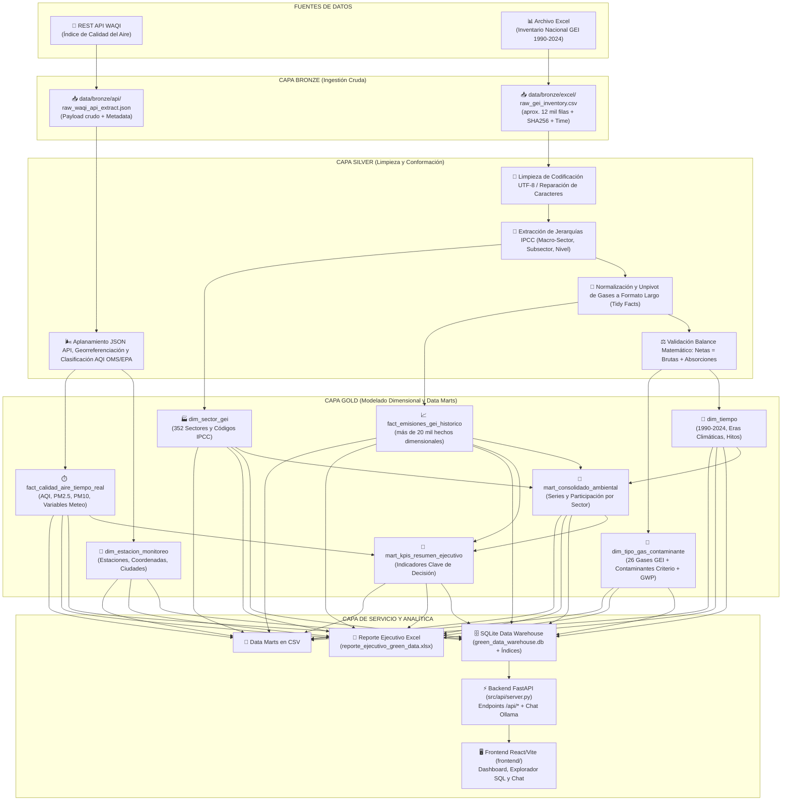
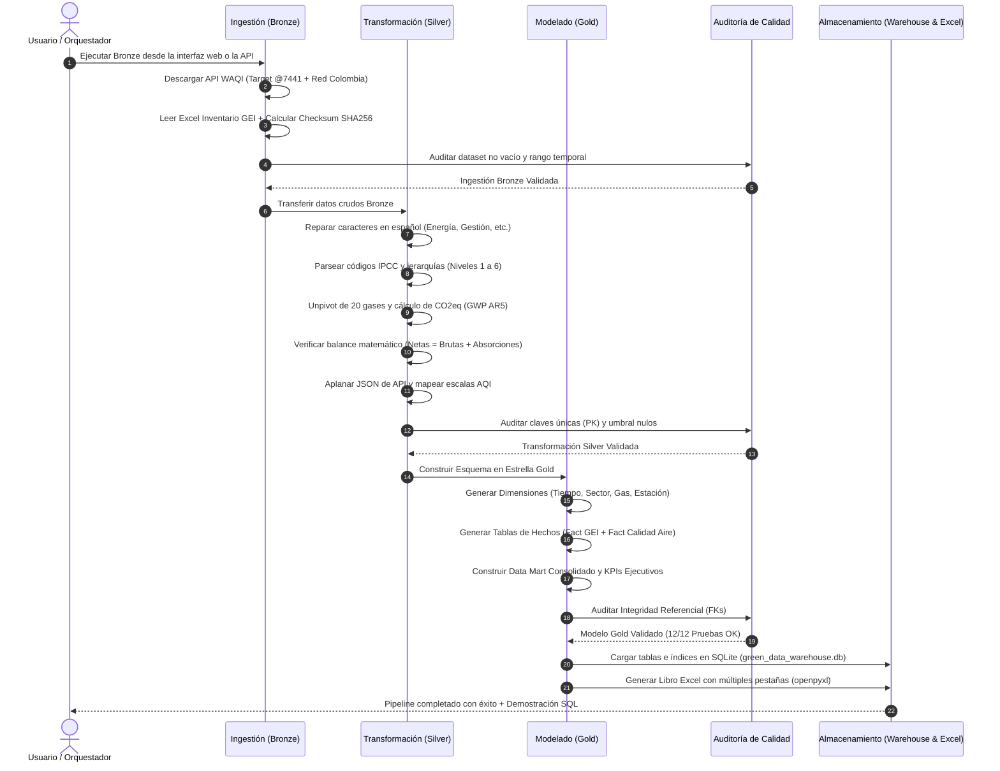

# 🌿 Green Data ETL Pipeline — Arquitectura Medallion Hecho por Miguel Angel Herrera Santanilla Y Nayda Liseth Sierra Jaramillo

Pipeline de **Extracción, Transformación y Carga (ETL)** diseñado bajo la **Arquitectura Medallion (Bronze, Silver y Gold)** para la integración, limpieza y análisis de datos ambientales estratégicos: el **Inventario Nacional de Gases de Efecto Invernadero (GEI) de Colombia (1990–2024)** y las mediciones de calidad del aire consultadas mediante la **API REST WAQI**.

---

## 📑 Tabla de Contenidos

1. [Resumen Ejecutivo y Objetivos](#-resumen-ejecutivo-y-objetivos)
2. [Arquitectura General del Sistema (Medallion)](#-arquitectura-general-del-sistema-medallion)
3. [Flujo de Procesamiento de Datos](#-flujo-de-procesamiento-de-datos)
4. [Modelo Dimensional (Esquema en Estrella y Data Marts)](#-modelo-dimensional-esquema-en-estrella-y-data-marts)
5. [Fuentes de Información](#-fuentes-de-información)
6. [Detalle de Transformaciones por Capa](#-detalle-de-transformaciones-por-capa)
7. [Gobernanza y Auditoría de Calidad de Datos](#-gobernanza-y-auditoría-de-calidad-de-datos)
8. [Aplicación Web: Backend FastAPI y Frontend React/Vite](#-aplicación-web-backend-fastapi-y-frontend-reactvite)
9. [Estructura del Repositorio](#-estructura-del-repositorio)
10. [Guía de Instalación y Ejecución](#-guía-de-instalación-y-ejecución)
11. [Consultas Analíticas SQL y Toma de Decisiones](#-consultas-analíticas-sql-y-toma-de-decisiones)
12. [Verificación, Preguntas Frecuentes y Glosario](#-verificación-preguntas-frecuentes-y-glosario)

---

## 🎯 Resumen Ejecutivo y Objetivos

El objetivo principal es construir un flujo de datos robusto, escalable y reproducible en **Python** que unifique dos fuentes ambientales clave:

1. **Fuente Tabular / Batch (Excel):** Serie histórica oficial de inventario de gases de efecto invernadero (aproximadamente 12 mil registros, categorizados por directrices IPCC para el periodo 1990–2024).
2. **Fuente API REST:** Mediciones recientes de contaminantes criterio del aire ($PM_{2.5}$, $PM_{10}$, $O_3$, $NO_2$, $SO_2$, $CO$) e Índice de Calidad del Aire (AQI) provistos por el proyecto *World Air Quality Index* (WAQI). La API se consulta al ejecutar Bronze; no se mantiene una transmisión continua.

A través del pipeline, los datos sin procesar se transforman progresivamente en un **Data Warehouse analítico en SQLite** y un **Reporte Ejecutivo en Excel**, permitiendo a tomadores de decisiones evaluar trayectorias de descarbonización, cumplimiento de las NDC 2030 y alertas tempranas de contaminación urbana.

---

## 🏛 Arquitectura General del Sistema (Medallion)



---

## 🔄 Flujo de Procesamiento de Datos



---

## 🌟 Modelo Dimensional (Esquema en Estrella y Data Marts)


---

## 📊 Fuentes de Información

| Fuente                                   | Tipo          | Formato Original  | Volumen / Frecuencia                                  | Descripción                                                                                                             |
| :--------------------------------------- | :------------ | :---------------- | :---------------------------------------------------- | :----------------------------------------------------------------------------------------------------------------------- |
| **Inventario Nacional GEI**        | Archivo Local | Excel (`.xlsx`) | Aproximadamente 12 mil registros / Anual (1990–2024) | Emisiones históricas de GEI en Colombia clasificadas según metodología IPCC.                                          |
| **World Air Quality Index (WAQI)** | REST API      | JSON              | Tiempo real / Estaciones Urbanas                      | Mediciones de calidad del aire ($PM_{2.5}$, $PM_{10}$, $O_3$, etc.), geolocalización y variables meteorológicas. |

> [!NOTE]
> **Resolución de la API**: La extracción consulta la estación configurada y busca estaciones en ciudades colombianas (Bogotá, Medellín, Cali y Barranquilla). WAQI se consulta durante la ejecución de Bronze; no es una transmisión continua.

---

## 🛠 Detalle de Transformaciones por Capa

### 1. Capa Bronze (Raw Ingestion)

- **Excel Ingestion**: Lectura fiel de las 47 columnas de la hoja `Data`, cálculo del hash criptográfico `SHA-256`, tamaño en bytes y adición de metadatos técnicos (`_ingested_at`, `_source_file`, `_source_row_index`).
- **API Ingestion**: Consulta HTTP con reintentos y persistencia completa del JSON crudo con cabeceras y códigos de respuesta en `data/bronze/api/raw_waqi_api_extract.json`.

### 2. Capa Silver (Cleaning & Conformance)

- **Reparación de Encodings**: Corrección de textos corruptos en español (e.g. `AO` $\rightarrow$ `anio`, `Energa` $\rightarrow$ `Energía`, `Gestin` $\rightarrow$ `Gestión`, `Maz` $\rightarrow$ `Maíz`, `Bfalos` $\rightarrow$ `Búfalos`).
- **Parsing de Jerarquías IPCC**: Extracción mediante expresiones regulares del código IPCC (e.g. `3.B.1.a.iv.1`), macro-sector (`1. Energía`, `2. IPPU`, `3. AFOLU`, `4. FOLU`, `5. Residuos`), subsector, descripción de la actividad y nivel de profundidad (1 al 6).
- **Unpivot y Normalización Dimensional**: Transformación del formato ancho (wide) a formato ordenado (tidy/long), generando más de 20 mil hechos granulares de gases con su respectivo potencial de calentamiento global ($CO_2$, $CH_4$, $N_2O$, $SF_6$, HFCs, PFCs, HFOs).
- **Validación de Balance Físico**: Verificación de la identidad contable ambiental:

  $$
  \text{Emisiones Netas} = \text{Emisiones Brutas} + \text{Absorciones}
  $$

  *(Donde las absorciones de sumideros forestales se expresan con signo negativo en el inventario)*. Satisfacción del 100% de los registros.
- **Normalización de Calidad del Aire**: Desanidación de variables meteorológicas y contaminantes, cálculo de categorías de riesgo según la escala EPA/OMS (Buena, Moderada, Dañina para Grupos Sensibles, Dañina, Muy Dañina, Peligrosa).

### 3. Capa Gold (Dimensional Modeling & Data Marts)

- **Esquema en Estrella**: 4 tablas de dimensiones (`dim_tiempo`, `dim_sector_gei`, `dim_tipo_gas_contaminante`, `dim_estacion_monitoreo`) y 2 tablas de hechos (`fact_emisiones_gei_historico`, `fact_calidad_aire_tiempo_real`).
- **Data Mart Consolidado Ambiental**: Agregaciones anuales por macro-sector con cálculo de participación porcentual nacional y trayectoria de emisiones.
- **Data Mart de KPIs Ejecutivos**: Métricas macro para toma de decisiones (Emisiones netas 2024, CAGR histórico 1990–2024, capacidad de absorción forestal, sector de mayor impacto y alerta en tiempo real).
- **Almacenamiento y Salidas**: Base de datos relacional SQLite `green_data_warehouse.db` con índices optimizados y libro de trabajo Excel `reporte_ejecutivo_green_data.xlsx`.

---

## 🛡 Gobernanza y Auditoría de Calidad de Datos

El pipeline incorpora un motor automatizado de pruebas de calidad (`DataQualityChecker`) para comprobar reglas como las siguientes. El resultado concreto de cada auditoría depende de los datos generados y se puede consultar en la pestaña **Auditoría de Calidad** o en el endpoint de auditoría del backend.

| Capa             | Regla de calidad                                                                                                                         |
| :--------------- | :--------------------------------------------------------------------------------------------------------------------------------------- |
| **Bronze** | Verifica que la extracción contenga datos y que los años estén dentro del rango esperado.                                             |
| **Silver** | Comprueba que existan hechos y estaciones, que las claves de los catálogos sean únicas y que las columnas críticas no estén vacías. |
| **Silver** | Valida el rango del AQI y el balance de emisiones netas, brutas y absorciones.                                                           |
| **Gold**   | Comprueba la integridad referencial entre hechos y dimensiones de tiempo, sector, gas y estación.                                       |

---

## 🖥️ Aplicación Web: Backend FastAPI y Frontend React/Vite

La aplicación web permite operar el pipeline y consultar los resultados Gold desde el navegador:

- **Pipeline Medallion:** ejecuta Bronze, Silver y Gold por separado y muestra el estado de las capas y el resultado de cada operación.
- **Dashboard:** presenta KPIs, tendencias históricas, sectores y mediciones de calidad del aire.
- **Consultas IA:** permite preguntar en español sobre el resumen Gold mediante Ollama, un servicio local opcional.
- **Explorador SQL:** envía consultas `SELECT` al Data Warehouse SQLite y muestra los resultados.
- **Auditoría de calidad:** ejecuta comprobaciones de claves únicas e integridad referencial.
- **Reporte ejecutivo:** FastAPI expone el resumen ejecutivo y la auditoría como datos JSON; Gold también genera un libro Excel con pestañas para KPIs, sectores, calidad del aire, una muestra de hechos GEI y el catálogo de gases.

El backend se encuentra en `src/api/server.py` y la interfaz en `frontend/`. La documentación interactiva de la API queda disponible en `http://localhost:8000/docs` al iniciar el backend. Ollama solo se necesita para la pestaña de consultas IA; no es requisito para las etapas ETL.

| Grupo                 | Rutas principales                                                                                                                                |
| :-------------------- | :----------------------------------------------------------------------------------------------------------------------------------------------- |
| Estado y pipeline     | `GET /api/health`, `GET /api/pipeline/status`, `POST /api/pipeline/execute`                                                                |
| Datos Gold            | `GET /api/data/kpis`, `/api/data/sectors`, `/api/data/trend`, `/api/data/air-quality`, `/api/data/gases`, `/api/data/time-dimension` |
| Consultas y chat      | `POST /api/data/sql` (solo `SELECT`), `POST /api/chat`, `GET /api/chat/status`                                                           |
| Reportes y auditoría | `GET /api/reports/executive`, `GET /api/reports/quality-audit`                                                                               |

---

## 📁 Estructura del Repositorio (Estructura Modular)

```text
├── .env.example                   # Plantilla de configuración local
├── config/
│   └── settings.py                # Rutas, variables de entorno y catálogos
├── data/
│   ├── bronze/                    # Entrada original: CSV de Excel y JSON de WAQI
│   ├── silver/                    # Datos limpios y normalizados en CSV
│   └── gold/                      # Dimensiones, hechos, data marts, SQLite y Excel
├── frontend/                      # Aplicación web React/Vite
│   └── src/
│       ├── App.jsx                # Panel, dashboard, chat, SQL y auditoría
│       └── index.css
├── logs/
│   └── etl_pipeline.log
├── notebooks/
│   └── analisis_ambiental_gei_waqi.ipynb
├── src/
│   ├── api/server.py              # API FastAPI, ejecución ETL y consultas Gold
│   ├── extract/                   # Extracción de Excel y WAQI
│   ├── transform/                 # Transformaciones Bronze → Silver → Gold
│   ├── load/database_loader.py    # Carga SQLite y generación de Excel
│   ├── quality/                   # Validaciones de calidad
│   └── utils/                     # Logging y utilidades compartidas
├── test/
│   └── test_etl.py                # Pruebas unitarias y de integración
├── Series_Históricas_...xlsx      # Inventario Nacional GEI de origen
├── requirements.txt               # Dependencias Python
└── GUIA_DEL_PROYECTO.md           # Guía breve de explicación y presentación
```

---

## 🚀 Guía de Instalación y Ejecución

### Requisitos previos

- Python 3.10 o superior.
- Node.js y npm para la interfaz web.
- Conexión a Internet y un token WAQI para ejecutar Bronze.
- Ollama y el modelo configurado, únicamente si se quiere utilizar el chat IA.

### Configuración e instalación

Desde PowerShell, en la raíz del repositorio:

```powershell
python -m venv .venv
.\.venv\Scripts\Activate.ps1
python -m pip install -r requirements.txt
Copy-Item .env.example .env
```

Edita `.env` y asigna tu token en `WAQI_API_TOKEN`. El archivo `.env` contiene configuración local y no debe publicarse. Las variables opcionales de WAQI, Ollama y el servidor tienen valores predeterminados documentados en `.env.example`.

Instala las dependencias del frontend:

```powershell
Set-Location frontend
npm install
Set-Location ..
```

### Iniciar la aplicación

Abre dos terminales desde la raíz del repositorio. En la primera, activa el entorno virtual e inicia FastAPI:

```powershell
.\.venv\Scripts\Activate.ps1
python -m uvicorn src.api.server:app --host 127.0.0.1 --port 8000 --reload
```

En la segunda, inicia Vite y abre la dirección indicada en la terminal (por defecto `http://localhost:3000`):

```powershell
Set-Location frontend
npm run dev
```

La API está disponible en `http://localhost:8000`; su documentación interactiva está en `http://localhost:8000/docs`.

### Ejecutar el pipeline

En la pestaña **Pipeline Medallion** de la aplicación, ejecuta las capas en orden:

1. **Bronze:** consulta WAQI y lee el archivo Excel de origen.
2. **Silver:** procesa los datos guardados en Bronze.
3. **Gold:** crea dimensiones, hechos y data marts, y carga SQLite y el reporte Excel.

Silver requiere Bronze y Gold requiere Silver. La extracción de calidad del aire es una captura de la consulta a WAQI, no un proceso continuo. Para actualizarla, vuelve a ejecutar las capas en orden.

### Activar el chat IA (opcional)

Instala e inicia Ollama y descarga el modelo configurado por defecto:

```bash
ollama pull qwen2.5:1.5b
```

El modelo y el servicio se pueden configurar mediante `OLLAMA_MODEL` y `OLLAMA_BASE_URL` en `.env`. El chat utiliza el resumen de datos Gold disponible en SQLite; no participa en el procesamiento ETL.

### Pruebas automatizadas

```powershell
python -m unittest test.test_etl
```

Las pruebas de integración extraen el Excel y consultan WAQI, por lo que necesitan el archivo fuente y conexión a Internet. También escriben resultados en las carpetas de datos configuradas.

### Compartir una demostración temporalmente (opcional)

Con el backend y Vite activos, se puede exponer Vite mediante Cloudflare Tunnel:

```powershell
cloudflared tunnel --url http://127.0.0.1:3000
```

El enlace `trycloudflare.com` es temporal y público mientras el túnel esté activo. Compártelo solo con personas de confianza y detén el túnel con `Ctrl+C` al terminar.

---

## 💡 Consultas Analíticas SQL y Toma de Decisiones

La base de datos SQLite `data/gold/green_data_warehouse.db` contiene las tablas e índices listos para conectarse a herramientas de BI (Power BI, Tableau) o ejecutarse mediante consultas SQL:

### Consulta 1: Balance de Emisiones por Macro-Sector en el Año 2024

```sql
SELECT 
    anio,
    sector_macro_nombre,
    ROUND(emisiones_brutas_kt, 2) AS emisiones_brutas_kt,
    ROUND(absorciones_kt, 2) AS absorciones_kt,
    ROUND(emisiones_netas_kt, 2) AS emisiones_netas_kt,
    participacion_pct || '%' AS participacion_nacional
FROM mart_consolidado_ambiental
WHERE anio = (SELECT MAX(anio) FROM mart_consolidado_ambiental)
ORDER BY emisiones_brutas_kt DESC;
```

**Resultado Obtenido:**

- **1. Energía:** $105,306.19\text{ kt } CO_2eq$ (**40.71%** de las emisiones brutas nacionales).
- **2. Agricultura (AFOLU):** $58,033.37\text{ kt } CO_2eq$ (**22.43%**).
- **3. Silvicultura y Usos de la Tierra (FOLU):** $57,689.79\text{ kt } CO_2eq$ (**22.30%** brutas) con **$-12,195.55\text{ kt } CO_2eq$ de absorciones forestales**.
- **4. Residuos:** $25,982.20\text{ kt } CO_2eq$ (**10.04%**).
- **5. Procesos Industriales (IPPU):** $11,669.23\text{ kt } CO_2eq$ (**4.51%**).

---

### Consulta 2: Calidad del Aire Consultada por Estación

```sql
SELECT 
    e.estacion_nombre,
    e.ciudad,
    f.aqi,
    f.aqi_categoria,
    f.contaminante_dominante,
    f.pm25,
    f.pm10,
    f.temperatura_c
FROM fact_calidad_aire_tiempo_real f
JOIN dim_estacion_monitoreo e ON f.estacion_id = e.estacion_id
ORDER BY f.aqi DESC;
```

---

### 📌 Hallazgos Clave para Políticas Ambientales

1. **Prioridad en Descarbonización del Sector Energía (40.7%):** El transporte vehicular y la generación termoeléctrica concentran el mayor crecimiento ($CAGR = +1.06\%$ anual). Se requiere acelerar la electrificación de flotas y matrices renovables.
2. **Preservación de Sumideros Forestales (FOLU):** Las absorciones forestales mitigan más de $12,000\text{ kt } CO_2eq$ anuales. Combatir la deforestación en la Amazonía y cordilleras es vital para mantener la meta de carbono neutralidad 2050.
3. **Puntos Críticos Urbanos en Calidad del Aire:** Las estaciones urbanas (como Centro de Alto Rendimiento y Kennedy en Bogotá) permiten comparar concentraciones de $PM_{2.5}$ con los sectores emisores. Las mediciones dependen de la captura más reciente consultada a WAQI y no representan un flujo continuo.

---

## ✅ Verificación, Preguntas Frecuentes y Glosario

### ¿Cómo comprobar que la ejecución terminó?

- La pestaña **Pipeline Medallion** muestra el estado de Bronze, Silver y Gold y el resultado de la última ejecución.
- Los registros se guardan en `data/pipeline_execution.log` y `data/api_server.log`; el log general del ETL está en `logs/etl_pipeline.log`.
- Revisa los CSV de cada capa en `data/bronze/`, `data/silver/` y `data/gold/`.
- La base `data/gold/green_data_warehouse.db` contiene las tablas consultadas por el dashboard.
- La pestaña **Auditoría de Calidad** presenta las comprobaciones ejecutadas y su resultado.
- Gold genera `data/gold/reporte_ejecutivo_green_data.xlsx`.

### Preguntas frecuentes

**¿La calidad del aire se actualiza continuamente?**

No. Bronze consulta WAQI y conserva la respuesta obtenida en esa ejecución. Para obtener otra captura, vuelve a ejecutar Bronze y luego Silver y Gold.

**¿Se necesita Ollama para procesar los datos?**

No. Ollama solo se utiliza para las consultas en lenguaje natural de la pestaña IA. Las etapas ETL, el dashboard, SQL y el reporte Excel funcionan con el backend y los datos Gold.

**¿Por qué se conservan CSV/JSON además de SQLite?**

Bronze conserva los datos de origen y permite rastrear qué se recibió; Silver deja las fuentes limpias y normalizadas; Gold organiza los datos para consultas y reportes. SQLite es el almacén analítico local, no reemplaza las capas anteriores.

**¿Qué significa que SQLite sea local?**

El almacén es un archivo dentro del proyecto; no requiere instalar ni administrar un servidor de base de datos aparte.

### Glosario

| Término                 | Significado                                                                  |
| :----------------------- | :--------------------------------------------------------------------------- |
| **ETL**            | Extraer, transformar y cargar datos.                                         |
| **GEI**            | Gases de efecto invernadero.                                                 |
| **IPCC**           | Referencia metodológica utilizada para clasificar categorías de emisiones. |
| **AQI**            | Índice que resume la calidad del aire.                                      |
| **API**            | Interfaz que permite intercambiar datos entre programas.                     |
| **Data Warehouse** | Almacén organizado para consultas y análisis.                              |
| **Ollama**         | Servicio para ejecutar modelos de lenguaje localmente.                       |

La [guía sencilla del proyecto](./GUIA_DEL_PROYECTO.md) complementa este README con una explicación breve del flujo de datos y un guion para presentar el proyecto.
